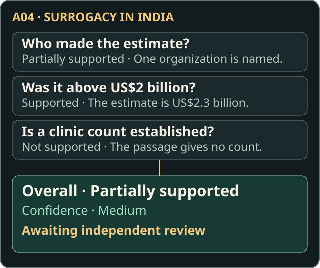
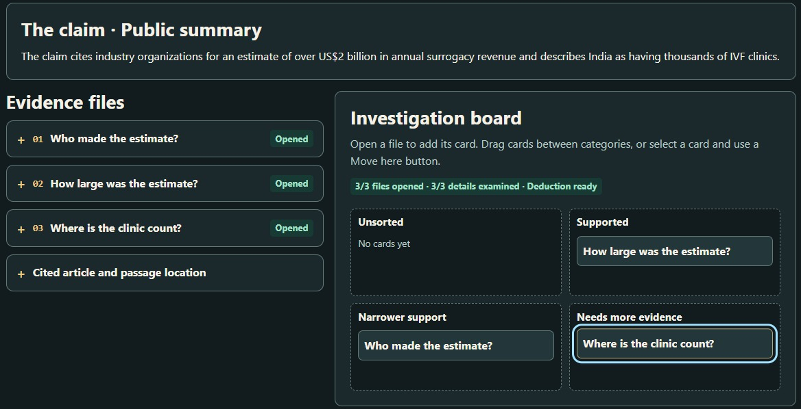

# Wikipedia Claim–Source Verification Library

## The problem

**Does the source actually support what Wikipedia says?**

A **claim** is a statement you can check. Its **citation** points to the source behind it. But a source can discuss the same topic without supporting every detail. Checking the citation means finding what it supports. Deciding whether the claim itself is true may require other evidence.

This exploratory project started with five Wikipedia examples. **The library organizes the research**, keeping claims, sources, and reasoning together. **Evidence Desk helps people practice** the same process through an interactive activity. The five original human assessments still await independent review.

**Planning an independent review?** Start with the [Blind Review Kit](docs/BLIND_REVIEW_KIT.md). The example below reveals the A04 assessment.

## A real example

**Wikipedia claim, summarized:** Industry organizations estimated annual surrogacy revenue above US$2 billion, and India had thousands of IVF clinics.

I checked the [cited article](https://pmc.ncbi.nlm.nih.gov/articles/PMC10327345/). The recorded passage location is page 2, *Background*, paragraph 3, line 1.

| Detail being checked | What the source establishes |
| --- | --- |
| Who provided the estimate? | Names one organization, rather than multiple organizations. |
| Was the annual estimate above US$2 billion? | Reports an estimate of US$2.3 billion. |
| Were there thousands of IVF clinics? | The cited passage does not establish this. |

**My recorded assessment:** Partially supported, with medium confidence, awaiting independent review. Missing support for the clinic count does not establish that the count is false.

*Checking each detail makes the limits of the citation visible.*

## Why I started this project

This grew out of my participation in the Wiki Education Outreachy claim-verification exercise. Reaching a verdict was only part of the challenge. Explaining how I reached it, and making that explanation easy for someone else to check, mattered just as much.

I started this separate five-case pilot to explore how to record that reasoning. I kept passage locations, uncertainty, and the different assessments together so a later reviewer could follow or question a decision. I developed Evidence Desk as a companion activity for trying the process. The pilot was self-initiated, separate from the assigned exercise.

## How the verification process works

Read the claim, find its cited source, and check each important detail. Record where you found the evidence, your judgment, and what remains uncertain. Then invite someone else to check independently. Wikipedia contributors can use the same steps when reviewing a citation.

*The judgment should lead the next reader back to a passage.*

## What I built

- **[Five case records](records/)** make it possible to revisit a decision. They connect each claim with its source, passage locations, reasoning, and uncertainty.
- **[Assessment guidelines](annotation-guidelines.md)** explain how to record support, partial support, contradiction, or insufficient information. **[The review kit](docs/BLIND_REVIEW_KIT.md)** lets someone make their own assessment before seeing mine.
- **[Consistency and evaluation tools](docs/TECHNICAL.md)** flag missing or inconsistent information and check whether assessments meet the review requirements for scoring. The evaluator explains why a prediction is skipped or compares it with a human judgment that meets those requirements.
- **[Evidence Desk](https://uxer-janine.github.io/claim-source-benchmark-pilot/lab/game/)** lets learners investigate the surrogacy claim, sort evidence cards, and explain their judgment before comparing it with the recorded assessment.

*Each card represents a detail to check. This screenshot shows one way to sort them.*

## What I learned and what comes next

A verdict alone leaves important questions unanswered. In the surrogacy case, checking the amount, attribution, and clinic count separately makes it easier to see which evidence informed each judgment.

I also made the scoring safeguards explicit. Synthetic test cases show how matching overall verdicts can hide disagreement about individual details. These are tests of the tools, rather than completed independent reviews of the pilot.

All five human assessments remain provisional. No independent reference reviews are complete, and all 14 example predictions remain unscored. Some sources have access limits. Original Wikipedia revisions and some historical AI-run information are missing. Evidence Desk has one playable investigation and four previews. Model performance and learning outcomes have not been measured. The full *Claim Verification Report* stays private.

Next, I want to invite independent reviews, confirm passage locations and original revisions where possible, and test the learning materials with beginners. Those steps should guide further cases and development. See the [roadmap](docs/NEXT_STEPS.md).

## Explore the project

- **Beginners and educators:** Try [Evidence Desk](https://uxer-janine.github.io/claim-source-benchmark-pilot/lab/game/) or the [written lesson](learn/README.md). The lesson works through [A01, American pika](learn/README.md#a01--american-pika), before [A04, surrogacy](learn/README.md#a04--surrogacy-in-india).
- **Researchers:** Read the [case summaries](docs/INVESTIGATIONS.md), [Research Notes](docs/RESEARCH_NOTES.md), and [methodology](annotation-guidelines.md). Continue with [A03 on context](docs/INVESTIGATIONS.md#a03--extensive-farming), [A08 on relevance](docs/INVESTIGATIONS.md#a08--curly-girl-method), or [B09 on editing and research](docs/INVESTIGATIONS.md#b09--reliability-of-wikipedia).
- **Independent reviewers:** Use the [Blind Review Kit](docs/BLIND_REVIEW_KIT.md) for a case whose assessment you have not seen.
- **Developers:** Start with the [Technical Guide](docs/TECHNICAL.md), [Data Dictionary](docs/DATA_DICTIONARY.md), or [Maintainer Guide](docs/MAINTAINER.md).
- **Contributors:** [Suggest a correction or submit a review](CONTRIBUTING.md). The [Portfolio Handover](docs/PORTFOLIO_HANDOVER.md) summarizes the contribution.

The [assessment guide](annotation-guidelines.md#terms-used-in-an-assessment) explains technical terms and the [verdict labels](annotation-guidelines.md#verdicts).

## Contribution and AI assistance

Janine Makorre prepared the research report and original human assessments, guided the methodology and learning design, and reviewed the presentation. AI assistance was used to implement the validation and evaluation tools and Evidence Desk, and to draft and edit documentation. The records identify historical AI assessments separately from the original human judgments.

See the [attribution and licensing notice](NOTICE.md) for Wikipedia credits, source rights, and the scope of the [MIT License](LICENSE).
