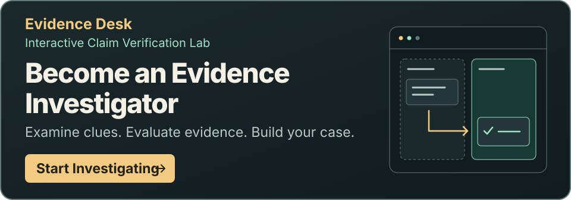
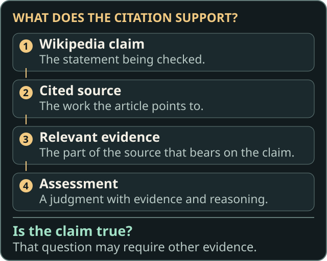
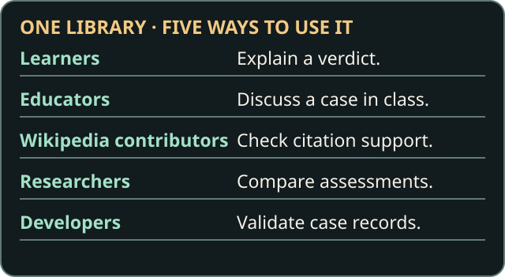

# Wikipedia Claim–Source Verification Library

**Does the cited source actually support what a Wikipedia claim says?**

Wikipedia articles often point to sources so readers can check what they say. Sometimes a source backs one detail but leaves another open. This library lets you practice spotting the difference with five real cases from Janine Makorre’s Wiki Education Outreachy contribution.

[Start the five-minute Markdown lesson](learn/README.md) · [Explore the investigations](#explore-the-investigations)

## Find your starting point

- **Learn the basics.** Follow the [written lesson](learn/README.md) for a worked example and a practice case.
- **Try an investigation.** In [Evidence Desk](https://uxer-janine.github.io/claim-source-benchmark-pilot/lab/game/), open evidence files, sort clues, and explain your verdict. The surrogacy case is playable.
- **Explore the findings.** Read the [five case summaries](docs/INVESTIGATIONS.md), with citations, passage locations, and assessments you can reveal after forming your own view.
- **Understand the method.** Read [How to Assess a Claim](annotation-guidelines.md) for evidence, verdicts, and independent review.
- **Use the data.** Start with the [Data Dictionary](docs/DATA_DICTIONARY.md), then use the [Technical Guide](docs/TECHNICAL.md) to check records or run the example evaluator.
- **Contribute.** See [what to include in feedback or a review](CONTRIBUTING.md).

## How verification works

1. Read the claim. If it makes several checkable statements, separate them.
2. Open the cited source and find the part relevant to each statement.
3. Compare the wording. Check details such as who, how many, where, when, and words like “about” or “may.”
4. Record what the source supports, where you found it, and what remains uncertain.

A claim can be true even when the cited source fails to support it. Finding out whether it is true may require other evidence.

## Words you’ll see

- **Claim** — A statement you can check, such as an approximate age.
- **Cited source** — The article, book, or other work the claim points to.
- **Evidence** — The specific part of that source that bears on the claim, such as a reported average.
- **Subclaim** — One independently checkable part of a larger claim, such as who made an estimate.
- **Assessment** — The full account of a check, including evidence, reasoning, and a verdict if one can be reached.
- **Verdict** — A label for how the cited source relates to the claim, such as **Partially supported**.
- **Confidence** — How sure an assessor is about their judgment.
- **Uncertainty** — What might change the judgment, such as missing context or ambiguous wording.
- **Reference assessment** — A human assessment considered for evaluation. Scoring requires agreement or adjudication based on at least two distinct, independent, confirmed human assessments. The five pilot assessments still await review.

See the [verdict key](annotation-guidelines.md#verdicts) for the five labels and what to do when you cannot access enough evidence.

## Explore the investigations

The short IDs identify the five investigations in the records and guides. Start with the pika example, practice on surrogacy, then explore time, relevance, and research scope.

1. **A01 — American pika.** Can a reported average support an approximate age? [Worked example](learn/README.md#a01--american-pika)
2. **A04 — The Missing Evidence: Surrogacy in India.** Who made the revenue estimate, does it clear the stated threshold, and does the source give a clinic count? [Written practice](learn/README.md#a04--surrogacy-in-india)
3. **A03 — Extensive farming.** Does a historical example from Mongolia support a broader statement about herding? [Case summary](docs/INVESTIGATIONS.md#a03--extensive-farming)
4. **A08 — Curly Girl Method.** Does evidence about a hair-care method’s popularity support a claim about changing beauty standards? [Case summary](docs/INVESTIGATIONS.md#a08--curly-girl-method)
5. **B09 — Reliability of Wikipedia.** What does a study of anonymous contributions establish about reliability, productivity, and editing rules? [Case summary](docs/INVESTIGATIONS.md#b09--reliability-of-wikipedia)

A04 is the only playable Evidence Desk investigation in the current release. The other four can be explored in the written lesson or case summaries and records.

## What the library preserves

- **Separate checks for complex claims.** The surrogacy case separates who made the estimate, the amount, and the clinic count. This lets a reviewer see which detail led to partial support.
- **A route back to the evidence.** Citations and recorded page, section, paragraph, or line details help others revisit the same passage.
- **Reasoning alongside verdicts.** Confidence and uncertainty explain how firmly the assessor holds a judgment and what might change it.
- **Distinct voices and review history.** Original human and historical AI assessments remain separate. Independent reviews can be added without replacing earlier judgments, and disagreements can be recorded.
- **Records people and tools can inspect.** The [public case files](records/) use a consistent JSON structure so readers can trace decisions and researchers can check or process them.

## Put the Library to Work

- **Learners:** Try the [surrogacy exercise](learn/README.md#a04--surrogacy-in-india), write a reason, and compare it with the documented assessment.
- **Educators:** Ask pairs to defend which surrogacy detail the source supports and name evidence that would settle the clinic count. Use the [case findings](docs/INVESTIGATIONS.md#a04--the-missing-evidence-surrogacy-in-india) to guide discussion afterward.
- **Wikipedia contributors:** Use the [farming case](docs/INVESTIGATIONS.md#a03--extensive-farming) to practice checking time and place before suggesting a narrower sentence or a stronger citation.
- **Researchers:** Compare the recorded human and AI reasoning in the [case files](records/), or use the [review method](annotation-guidelines.md#independent-review-and-adjudication) to document an independent judgment.
- **Developers:** Use the [Technical Guide](docs/TECHNICAL.md) to validate the JSON files and run the example evaluation.

## Project status and roadmap

This is an exploratory pilot. All five original human assessments await independent review and are excluded from scoring. The five cases cannot establish how well a verification tool performs. Original Wikipedia revisions and some AI run details are missing. Public records use labeled claim summaries and passage locations. The full *Claim Verification Report* remains with the private research materials.

See [research coverage and evidence](docs/RESEARCH_NOTES.md) for the five-case evidence map, what can be reproduced, and the limits of the historical human–AI comparison. See the [roadmap](docs/NEXT_STEPS.md) for next steps. If a source link fails or an explanation is unclear, [share feedback](CONTRIBUTING.md).

- **Independent reviewers:** Start with the [Blind Review Kit](docs/BLIND_REVIEW_KIT.md) before opening the existing assessments.
- **Mentors and portfolio readers:** See the [Portfolio Handover](docs/PORTFOLIO_HANDOVER.md) for a public summary of the contribution, deliverables, and limitations.

## Contribution and AI assistance

Janine Makorre prepared the research report and original human assessments, guided the methodology and learning design, and reviewed the presentation. AI assistance was used to implement the validation and evaluation tools and Evidence Desk, and to draft and edit documentation. The records identify historical AI assessments separately from the original human judgments.

See the [attribution and licensing notice](NOTICE.md) for Wikipedia credits, source rights, and the scope of the [MIT License](LICENSE).
