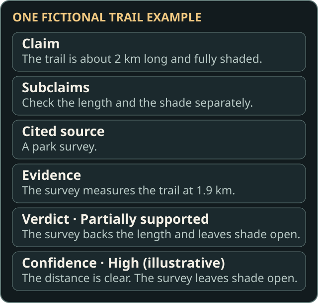
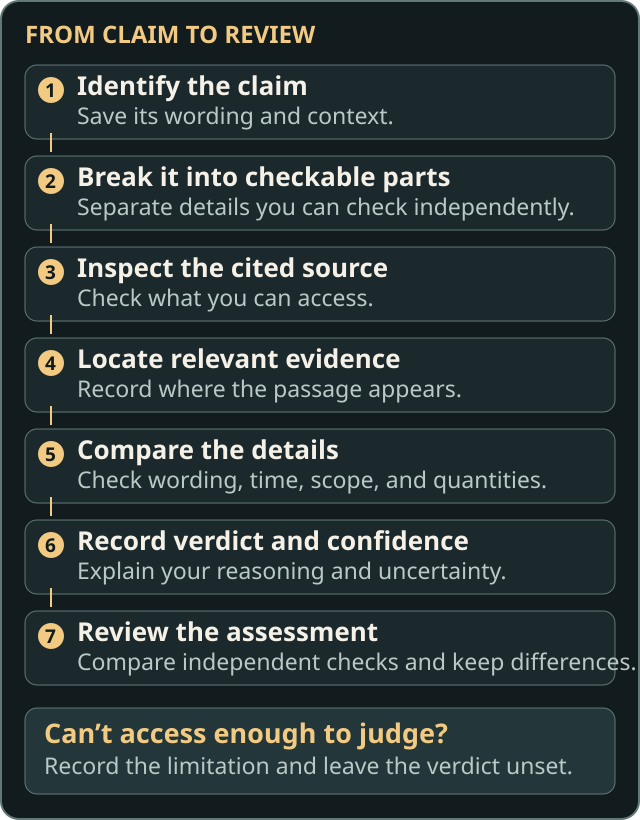
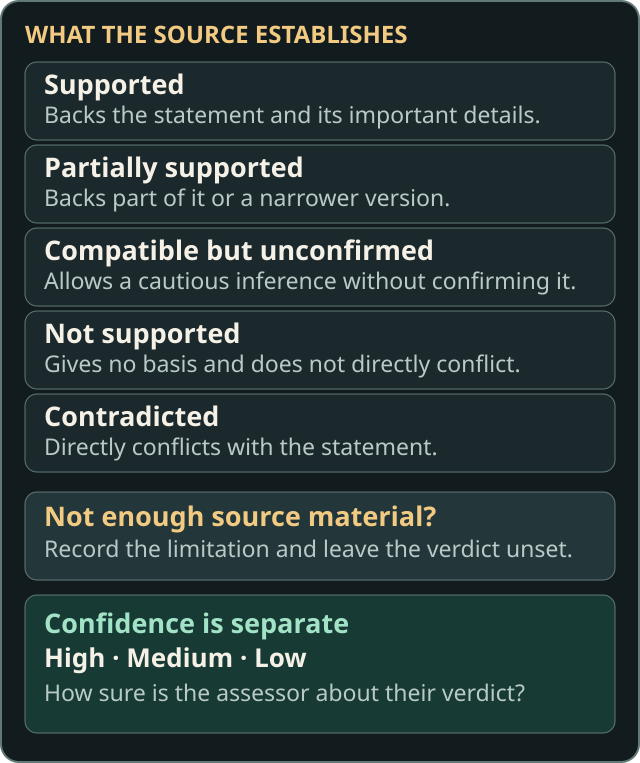
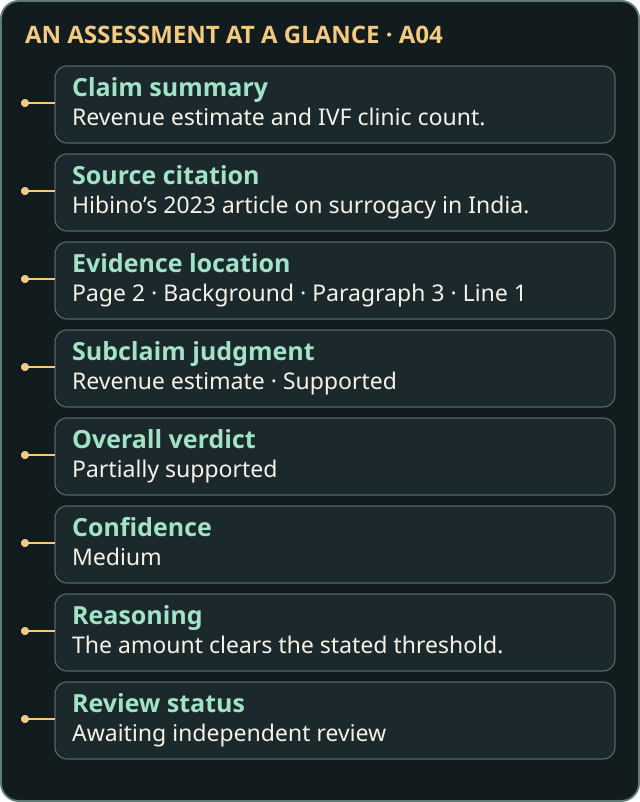

# How to Assess a Claim

[Back to the library](README.md) · [Practice on a case](learn/README.md)

Check what the cited source establishes. A statement might be true for other reasons even if its citation does not support it. Record facts you know from elsewhere separately as context.

## Terms used in an assessment

A **claim** is the statement being checked. Its **cited source** is the work it points to, and **evidence** is the specific part of that work relevant to the check. A **subclaim** is an independently checkable part of a larger claim. An **assessment** records the evidence, reasoning, verdict, confidence, and uncertainty. A **reference assessment** is a human assessment confirmed for use in evaluation. See the [beginner glossary](README.md#words-youll-see) for examples.

## Work through the claim

1. Read the claim and note the article context you used.
2. Separate the details that can be checked independently.
3. Locate the evidence and compare it with each detail.
4. Record the verdict, reasoning, and limits. Save your independent assessment before reading someone else’s.

## Compound claims

Keep the complete claim verbatim in the research record. Split substantive statements that can be checked independently. Give each subclaim a stable ID and its relevant verbatim fragment. Use ellipses to mark cuts. For a single unsplit claim, record one subclaim with identical text. Agree on the split before comparing independent reviews. Public copies can use labeled summaries where verbatim material is withheld.

[The surrogacy case](docs/INVESTIGATIONS.md#a04--the-missing-evidence-surrogacy-in-india) separates attribution, revenue, and clinic count. The original assessment judged them partially supported, supported, and not supported, respectively. Its mapping awaits individual review. [The Wikipedia reliability case](docs/INVESTIGATIONS.md#b09--reliability-of-wikipedia) has three subclaims with no individual verdicts. Its original overall verdict remains separate.

## Evidence and uncertainty

### Find and document evidence

Record the source and the smallest relevant passage. Give the page, section, paragraph, and line where available. In the research record, quote the passage verbatim. Keep the original location wording and preserve a shared location when it applies to multiple passages. Link each evidence item to the relevant subclaims or judgments.

Identify the role of each passage. It might settle a judgment, directly conflict with the claim, provide context, or simply be the closest relevant material you found. A subclaim judgment can cite an item that explains a contradiction or lack of support.

### Record access and context

Record access for each source and whether each assessment had enough material to judge. A different route to the same source may let you complete the check. If the source is inaccessible or the material is insufficient, explain the limitation and leave the verdict unset. If you read enough to judge that the source gives no basis for the claim, **Not supported** may apply. [The Curly Girl Method case](docs/INVESTIGATIONS.md#a08--curly-girl-method) includes differing historical judgments about the material available.

Keep the Wikipedia context you used with the assessment. Use a labeled **Claim summary** for public paraphrases and a labeled **Evidence summary** for explanatory paraphrases. Where quotation rights are unresolved, retain the citation and passage location. See the [attribution notice](NOTICE.md).

## Verdicts

Apply the first applicable rule to each subclaim. Check quantities, dates, who made an estimate, the places or groups involved, and whether a statement implies cause and effect. [The farming case](docs/INVESTIGATIONS.md#a03--extensive-farming) illustrates how evidence about the past can differ from a claim about current practice.

| Verdict | What the cited source establishes |
| --- | --- |
| Contradicted | It directly conflicts with the statement. |
| Supported | It establishes the statement’s meaning, including its substantive details. |
| Partially supported | It establishes part of the statement or a weaker, narrower, or differently attributed version. |
| Compatible but unconfirmed | It gives a basis for a cautious inference without directly confirming the statement. |
| Not supported | It gives no basis for the statement and no directly conflicting evidence. |

### Combine subclaim verdicts

Keep the individual judgments and their evidence alongside the overall verdict. Once all subclaims have verdicts, apply the first rule that fits:

1. If all are **Supported**, use **Supported**.
2. Otherwise, if any is **Supported** or **Partially supported**, use **Partially supported**.
3. Otherwise, if any is **Compatible but unconfirmed**, use **Compatible but unconfirmed**.
4. Otherwise, if any is **Contradicted**, use **Contradicted**.
5. Otherwise, use **Not supported**.

Keep each contradicted subclaim visible and flag it even when the overall verdict uses another label. The evaluator reports that flag from the recorded label in its unscored diagnostics. Investigate discrepancies between the combined result and a historical overall verdict while preserving the historical assessment.

## Confidence and uncertainty

Confidence is separate from the verdict. **High** means you expect a second assessor to reach the same conclusion. **Medium** allows reasonable differences in interpretation. **Low** reflects unclear or incomplete evidence. Describe what might change the judgment in the uncertainty note. Preserve the original confidence and uncertainty text from the *Claim Verification Report*.

## Read an assessment

Check who made it, which source and passage it uses, what its verdict applies to, and what the assessor says remains uncertain. The five original human judgments still await independent review. Historical AI assessments show how other systems responded and cannot serve as reference assessments.

The surrogacy assessment illustrates how these fields fit together. Its source citation and passage location lead back to Hibino’s article, while its revenue judgment applies to just one subclaim. The overall verdict is **Partially supported**, with **medium confidence** and review still pending.

## Independent review and adjudication

Save your own assessment before seeing other judgments, and record any known exposure to human or AI assessments. Add each review separately. Compare verdicts, subclaims, evidence, and context. Keep disagreements and their reasons visible. If reviewers reach agreement or a decision is made to resolve the disagreement, document that result and its rationale separately. Mark open disagreements as unresolved.

A single human assessment remains a provisional reference candidate even after its evidence and annotations are confirmed. Benchmark scoring requires agreement or adjudication based on at least two distinct, identified human assessors. Each must complete the assessment independently and have it confirmed. For a compound reference, confirm its subclaim judgments and resolve any discrepancy in the combined verdict before scoring. Approval of the method and approval of a particular reference are separate decisions.

For either decision, record that each assessor had seen neither other human assessments nor AI output. If independence is undocumented or unresolved, leave the reference pending.

For agreement, the assessors must match the overall reference verdict and agree on every applicable subclaim verdict using the same breakdown. If verdicts or the breakdown differ, keep the case pending until adjudication. Record differences in how the claim was split using `different_sub_claim_split`.

For adjudication, record the adjudicator’s identifier, decision date, and rationale. Cite the confirmed human assessments used and explain how the decision resolves the disagreement, including any differences in the breakdown. Keep this decision separate from the original assessments.

## Technical conventions and special cases

- **Verdict keys in table order:** `contradicted`, `supported`, `partially_supported`, `compatible_not_confirmed`, `not_supported`.
- **Assessability:** Use `assessable` when there is enough material. Use `source_inaccessible`, `source_insufficient`, or `needs_review` for the corresponding limitation, with a null verdict. An assessable historical output with no explicit verdict can use the `needs_review` verdict placeholder. Keep explicit abstentions and leave unlabeled historical responses unmapped.
- **Evidence:** Use `decisive`, `contradicting`, `nearest_topical`, or `context` for passage roles. Retain the original location in `raw` and use null for unknown or inapplicable parts. When withholding a quotation, use `locator_only`, keep its source ID and location, and set `passage_text` to null. A locator still requires individual review for reference use. Use `public_summary` for public claim paraphrases. When a full-source search finds no passage, use `none_found_after_search` with a search note and leave unknown details unrecorded.
- **Review:** Use `human_original`, `human_independent_review`, or `ai_generated` to identify the assessment. AI assessments always have `reference_eligible: false`. Use `contested_unresolved` for an unresolved disagreement.

See the [Data Dictionary](docs/DATA_DICTIONARY.md) for field requirements and the [Technical Guide](docs/TECHNICAL.md) for checks.
