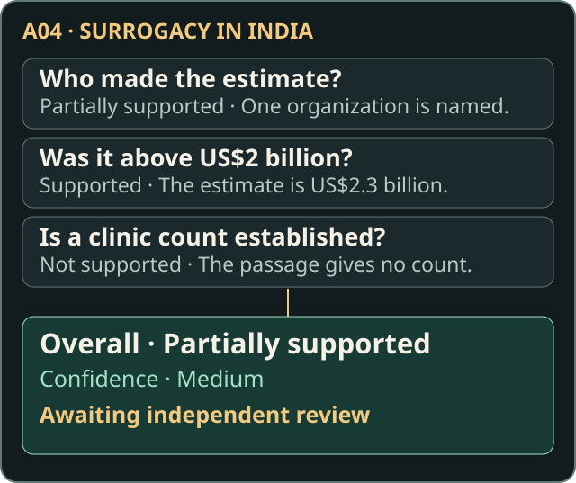

# Explore the investigations

[Back to the library](../README.md) · [Try the written lesson](../learn/README.md)

Use these case summaries to find the evidence and try a check before revealing the recorded judgment. Each case asks what one cited source supports. **Claim summaries** paraphrase the public records. **Evidence summaries** describe the cited material in our own words. The public records give passage locations in place of verbatim excerpts. The article links identify current Wikipedia pages because the exact revisions used in the exercise are unrecorded.

Try the check before opening each assessment. These are Janine Makorre’s original documented judgments, all awaiting independent review.

Each case links to its source and record. “Not supported” describes the citation’s limits. It does not establish that the claim is false. After reading, an independent reviewer still needs to check the passage, context, confidence, and reasoning. For a review without exposure to the existing judgments, use the [Blind Review Kit](BLIND_REVIEW_KIT.md) instead.

## Current three-case learning focus

The original exploration contains five cases. The current active sequence is **A01 → A04 → A03**. This selection describes the learning and research focus. It does not approve an assessment for scoring.

| Case | Role | What to examine |
| --- | --- | --- |
| [A01](#a01--american-pika) | Observe | How approximate wording relates to an average. |
| [A04](#a04--the-missing-evidence-surrogacy-in-india) | Practice | How to check separate details in a complex claim. |
| [A03](#a03--extensive-farming) | Investigate | How time, location, and context affect interpretation. |

A08 and B09 remain [additional exploratory cases](#additional-exploratory-cases) for future expansion. All five original files stay at their existing paths. The validator and historical evaluation example still use the complete collection.

### A01 · American pika

**Observe.** Start with the guided [written example](../learn/README.md#a01--american-pika). The recorded source has returned 403 to automated requests. The source summary and passage location remain available.

**Claim summary:** Young American pikas typically first open their eyes at approximately nine days old.

**Evidence summary:** The paper reports an average of nine days and credits earlier work. Find it on page 4, *Ontogeny and reproduction*, paragraph 6, line 3.

[Wikipedia article](https://en.wikipedia.org/wiki/American_pika) · [Smith and Weston, cited paper at page 4](https://academic.oup.com/mspecies/article-pdf/doi/10.2307/3504319/8071137/352-1.pdf#page=4) · [Case record](../records/pilot-a01.json)

Reveal the documented assessment

**Supported · High confidence.** The average fits an approximate age and leaves room for individual variation. The paper credits Whitworth for the figure, and further context could affect the judgment.

### A04 · The Missing Evidence: Surrogacy in India

**Practice.** Try the [written exercise](../learn/README.md#a04--surrogacy-in-india) or [Evidence Desk](https://uxer-janine.github.io/claim-source-benchmark-pilot/lab/game/) before opening the recorded assessment.

**Claim summary:** Industry organizations estimated annual surrogacy revenue above US$2 billion, and India had thousands of IVF clinics.

**Evidence summary:** The article names one industry organization, gives its annual estimate of US$2.3 billion, and describes clinics offering surrogacy without giving a total. Find the passage on page 2, *Background*, paragraph 3, line 1.

**Subclaims to check:** Who made the estimate, whether the amount exceeds US$2 billion, and whether the source gives a clinic count in the thousands.

[Wikipedia article](https://en.wikipedia.org/wiki/Surrogacy_in_India) · [Hibino, cited article](https://pmc.ncbi.nlm.nih.gov/articles/PMC10327345/) · [Case record](../records/pilot-a04.json)

Reveal the documented assessment

**Partially supported · Medium confidence.** The source names one organization, so the plural attribution has partial support. The amount clears the threshold. The clinic count is unsupported by the passage. The original assessment notes that the wording and additional context could affect the judgment.

### A03 · Extensive farming

**Investigate.** Compare the full wording with the historical Mongolia passage. Does the recorded reasoning address the scope of “some regions” and “may”? This question remains open to independent review.

**Claim summary:** Livestock management in some regions may involve seasonal practices or herding that is wholly or partly nomadic.

**Evidence summary:** The study describes a shift away from partly nomadic herding in Mongolia in the 1960s. The record locates the passage on page 11, paragraph 1, line 2.

[Wikipedia article](https://en.wikipedia.org/wiki/Extensive_farming) · [Morales-Reyes and colleagues, cited study](https://doi.org/10.1007/s13280-025-02150-8) · [Case record](../records/pilot-a03.json)

Reveal the documented assessment

**Not supported · High confidence.** The passage discusses a historical change in one place. It does not establish current practices or rule out those practices elsewhere. Unread sections or other sources could affect the assessment.

## Additional exploratory cases

These two cases are reserved for future expansion, outside the current three-case focus. Their records, evidence, assessments, and historical predictions are preserved. The existing game previews remain for compatibility.

### A08 · Curly Girl Method

**Claim summary:** Greater visibility of natural curls in media, fashion, and workplaces reflects broader acceptance of textured hair in beauty standards.

**Evidence summary:** The opening paragraph describes the hair-care method and its longstanding popularity. The record gives paragraph 1, line 1.

[Wikipedia article](https://en.wikipedia.org/wiki/Curly_Girl_Method) · [TODAY, cited article](https://www.today.com/shop/curly-girl-method-products-rcna100025) · [Case record](../records/pilot-a08.json)

Reveal the documented assessment

**Not supported · High confidence.** The passage is about the method and its popularity. It does not establish the claimed change in visibility or acceptance. Unchecked secondary citations could affect the verdict.

### B09 · Reliability of Wikipedia

**Claim summary:** Wikipedia permits anonymous editing without identification or email. The claim also attributes a 2009 study to Dartmouth College and says it ranked anonymous contributors among the most productive on English Wikipedia.

**Evidence summary:** The study’s abstract discusses how reliable contributions were. The two recorded passages share the location *Abstract*, lines 4–5.

**Subclaims to check:** B09.a — Anonymous Editing, B09.b — Identification Requirements, and B09.c — Research Findings on Anonymous Contributions. None has an individual verdict.

[Wikipedia article](https://en.wikipedia.org/wiki/Reliability_of_Wikipedia) · [Anthony, Smith, and Williamson, cited study](https://journals.sagepub.com/doi/10.1177/1043463109336804) · [Case record](../records/pilot-b09.json)

Reveal the original overall assessment

**Partially supported · Medium confidence.** The excerpt discusses reliability, while the claim concerns how much anonymous editors produced. It does not establish editing or registration requirements. The later evidence notes also leave the Dartmouth attribution and English Wikipedia scope open. The overall verdict applies to the whole claim.

